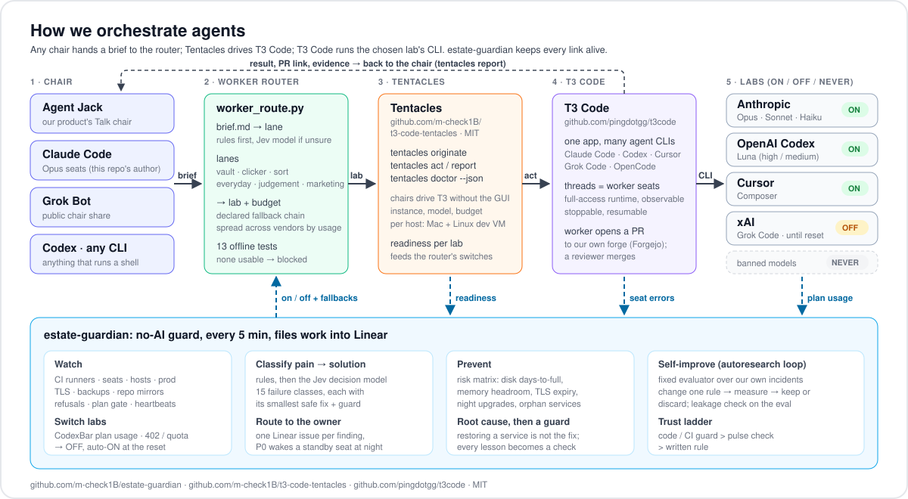

# estate-guardian

**estate-guardian keeps a team of AI coding agents working through the night, without a person watching.** We build our company's software with many AI agents at once (Claude, OpenAI Codex, Cursor and Grok), and they fail in boring ways: a plan runs out of credit, a CI runner dies, a disk fills up, a server restarts and a service does not come back. estate-guardian is a plain Python script with no AI inside. Every 5 minutes it checks all of that, sends each new job to an AI lab that is actually available right now, and opens a ticket with the fix when something breaks. Problems get caught at 3 a.m., not at breakfast.



## How we orchestrate agents

The point is the chain, and it works with any orchestrator ("chair"): [Agent Jack](https://agentjack.dev), Claude Code, the [Grok Bot](https://x.ai/bot/0fYZ_kKkiXNbLn_KBD3f3), Codex or anything else that can run a shell command.

1. **The chair writes a brief** (a Markdown file: what to do, picture of done).
2. **`worker_route.py` picks the lab.** It sorts the brief into a lane (vault, clicker, sort, everyday, judgement, marketing) and picks a lab and budget that are ON right now. If the first choice is out of usage it walks a declared fallback chain, and it spreads everyday work across vendors.
3. **[Tentacles](https://github.com/m-check1B/t3-code-tentacles) carries the job.** It is our open-source (MIT) command line for [T3 Code](https://github.com/pingdotgg/t3code): `tentacles originate` starts a worker thread with an exact instance, model and thought budget; `tentacles act` / `report` steer and read it; `tentacles doctor --json` says which labs are ready on each machine.
4. **[T3 Code](https://github.com/pingdotgg/t3code) runs the worker.** One app hosts many agent CLIs (Claude Code, Codex, Cursor, Grok Code, OpenCode) as threads you can watch, stop and resume. The worker opens a PR on our own forge and a reviewer merges.
5. **estate-guardian keeps the chain alive.** It reads lab readiness from Tentacles, plan usage from [CodexBar](https://github.com/steipete/CodexBar) and seat errors from T3, flips labs OFF and back ON, and files every failure into Linear with its smallest safe fix.

## Try it

```bash
git clone https://github.com/m-check1B/estate-guardian.git && cd estate-guardian
python3 -m unittest test_worker_route          # 13 offline router tests
ROUTER_NO_JEV=1 python3 worker_route.py some-brief.md "Fix the failing lint"
```

The router runs as is from `labs.example.json`. The guard needs your own `estate.local.json` (schema in `estate.example.json`: hosts, Linear team, Forgejo, probes); every estate-specific value lives there, outside git.

Main files:
- `guardian.py`: the 5-minute guard;
- `worker_route.py` + `labs.example.json`: the multi-lab router and its ON / OFF / NEVER policy;
- `classify.py` + `taxonomy.json`: the pain → solution classifier;
- `risk_matrix.json`: the prevention matrix;
- `install.sh`: the macOS launchd job; `publish-public.sh`: how this public copy is cut from our private repo.

Built by an AI reliability line (GUARDIAN, a Claude Code seat) after a run of night-time incidents, and published as a real working example. By [Verduona](https://verduona.com) · [Kraliki](https://kraliki.com) · [m-check1b.com](https://m-check1b.com). License: MIT.

---

GUARDIAN is the estate reliability line (Founder, 11 Oct 2026). This repo holds its **no-AI guards**: scripts that watch every line and host and file Linear issues, so night-time failures are caught by a machine, not by the Founder.

Owner: GUARDIAN (Opus integrator). Reviews: B3. Forgejo only, AGit PRs.

## What runs

`guardian.py` runs every 5 minutes on the Mac Pro, from the launchd agent `com.verduona.estate-guardian` (minutes :01, :06, :11 …, staggered from the Senior crons at :09/:24/:39/:54).

| Guard | Watches | Night failure class it stops |
|---|---|---|
| `ci` | Forgejo runner registrations online; runner daemons, runner containers and bridges (docker0, sphere0) in every CI guest; disk fsync latency; runs stuck > 75 min or waiting > 60 min; job containers older than 6 h | Sphere CI dead 17 h (docker0 deleted, 10 Oct); slow VM disk (11 Oct); NAS runner offline, Tentacles CI starved 14 h (10–11 Oct); orphan containers (10 Oct) |
| `handoffs` | B3-approved PRs still open; release captain `WAIT_SENIOR`; seat notes "→ Senior" / INFRA BLOCKER | the 3.17.32 cut waited 7 h; B3's infra note went unread |
| `lines` | each line's pulse heartbeat; Senior cron loss (pulse-watch wakes); errored and stuck seats on the Pro, dev-workers and the iOS mini; provider outages (one error signature across ≥3 seats); T3 alive | Senior crons dead every night 5–11 Oct; Grok 402 took out 19 seats (11 Oct) |
| `hosts` | Jupiter MemAvailable / load / disk / kernel OOM kills / guest state; dev-workers RAM; NAS, production, Pro and mini disks; CI guest reboots | three Jupiter OOMs 9–10 Oct; NAS at 89 % |
| `prod` | public health of Jack, Bezpečnost práce, CouncilNow, shop, Sphere; Sphere DB pool saturation; production SSH | Sphere lock convoy (10 Oct); fail2ban lock-out (10 Oct) |
| `instances` | every deployed instance in `~/Developer-artifacts/estate/INSTANCES.json` (config `instances_file`; schema `estate.instances.example.json`): HTTP status, latency, reported version (`version_field` or `release_source_sha`) against `expect_version_from` (`{"version": "..."}`). `inst-down-*` P0 for prod/customer, amber for staging; `inst-slow-*` > 3 s amber; `inst-drift-*` amber after 60 min; a bad registry is one `inst-registry` finding. Writes `~/Developer-artifacts/estate/PROD-STATUS.md`. Tests: `python3 -m unittest test_instances` | a customer instance down or left on an old release without anyone seeing it |
| `mirrors` | hourly: every private Forgejo repo's GitHub push mirror must target a private GitHub repo (P0 otherwise) | publishing the private estate-guardian when its public edition went to GitHub (11 Oct) |

## How it reports

- A finding that lasts past its grace period files **one** Linear issue titled `GUARDIAN: <key>` (team KRALIKI, labelled by owner: `lane:infra`, `to-senior`, `Syfon`, …). While it lasts, it comments at most hourly, or when the evidence changes.
- After 2 clean runs the issue gets a `RECOVERED` comment and moves to Done.
- **P0** findings also wake the standby Pulse Runner seat through Tentacles (at most every 30 min), so they are acted on at night when session crons are dead.
- `~/Developer-artifacts/GUARDIAN-STATUS.md`: line 1 is `GREEN|AMBER|RED`, then a table. Every pulse can read it.
- `~/Developer-artifacts/GUARDIAN-HEARTBEAT`: epoch seconds of the last run.
- Log: `~/Developer-artifacts/guardian/guardian.log`.

## Safety

- Read-only on every host. Production: `df`, `nc` and public HTTPS only. advertes_mini is never touched.
- The Linear key is read from the Keychain item named in the config (`linear.key_item`) and is never printed.
- Every estate-specific value (hosts, IPs, users, Linear IDs, repos, endpoints, Keychain item names) lives outside the repo in `~/Developer-artifacts/guardian/estate.local.json` (or `$ESTATE_CONFIG`). `estate.example.json` documents the schema with placeholders.

## Install / update

```bash
./install.sh
```

It links `~/Library/LaunchAgents/com.verduona.estate-guardian.plist` to this checkout and reloads it. Test without filing anything: `python3 guardian.py --dry-run [--only ci,hosts]`.

## Adding a guard

Every incident GUARDIAN root-causes ends here or in a product repo (playbook 18: corrections climb the ladder). Add a check that returns `F(key, owner, title, detail, grace, p0)` findings, run `--dry-run`, open an AGit PR, and cite the PR in `10-lessons.md`.

## Maintenance windows

Before a planned deploy or restart, the owning line (or GUARDIAN on its behalf) adds an entry to `~/Developer-artifacts/guardian/maintenance.json`, e.g. `{"prod-down-councilnow": {"until": <epoch>, "why": "deploy cn-3.0.3"}}`. The key is a finding-key prefix. Muted findings stay visible in `GUARDIAN-STATUS.md` but file nothing and wake nobody. When the window expires, alarms resume.

## Senior watch (Founder, 11 Oct 2026)

Senior's own thread is watched like every other line, with no exemption:
- `PULSE-HEARTBEAT` must be under 30 min old (the durable app watchdog is the primary pulse at >14 min, 11 Oct);
- a B3-approved PR must not stay open past 30 min;
- a captain `WAIT_SENIOR` must not wait past 15 min;
- a new "→ Senior" note must be seen by Senior's session within 30 min;
- cross-session messages to Senior must be read within 30 min (unread = newer than Senior's last turn);
- no timestamp Senior writes may run more than 3 min ahead of the real clock.

The two transcript checks read Senior's session transcript, which is the one that received GUARDIAN's "GUARDIAN → Senior" messages.

**Two-stage escalation:**
1. When a check trips, the finding goes to `guardian/senior-nudges.jsonl`, and GUARDIAN's session wakes Senior with SendMessage.
2. If the finding persists 45 min after it was queued (the 30-min durable pulse delivers the wake, then Senior gets 15 min), it files a `GUARDIAN:` to-senior issue and wakes the Pulse Runner.

When a clock slip has been corrected, GUARDIAN adds the body's first 60 characters to `clock_acked` in `guardian/state.json`. Only slips from the last 2 h count.

## Classifier: pain → solution (`classify.py`, `taxonomy.json`)

Every filed issue carries its failure class and **solution card**: the root-cause question, the smallest safe fix, the guard and the owner. A problem always points to its solution.

- **Tier 1:** finding-key prefixes and regex patterns. Free and deterministic.
- **Tier 2:** Jev, TypeSafe's decision model. It gives a typed choice over the taxonomy with probabilities, at about $0.04 per M tokens and ~300 ms. It runs only on free text that the rules miss. The key comes from the Keychain (Founder-authorized 11 Oct) and is never printed.
- **Tier 3:** cases with confidence below 0.6 go to `guardian/needs-judgment.jsonl`. GUARDIAN labels them and adds them to the playbook eval set, so the classifier learns from its misses.

Accuracy is measured by the playbook's autoresearch evaluator on a frozen eval set. The baseline on 11 Oct was rules 26/40, Jev 27/40, combined 31/40.

## Prevention matrix (`risk_matrix.json`, guard `predict`)

Leading indicators, checked every run, so problems are caught before they fail:
- disk days-to-full;
- Jupiter memory headroom;
- runner-label coverage;
- live IP pins to the dead .20 interface;
- pending night upgrades of docker/containerd/lxd;
- TLS days left;
- Senior heartbeat early warning;
- backup age;
- provider early warning.

`~/Developer-artifacts/RISK-MATRIX.md` holds the table, line 1 being the worst state. AMBER files a Low-priority issue and wakes no one. RED files an issue.

## Vault web guard (Founder, 11 Oct 2026: "use the key, not login over web")

Agents read credentials only through `~/bin/nasvault unlock|get|list|create`: the key-based Vaultwarden CLI, unlocked with the Keychain master, values never printed. The `vault` guard reads Chrome history in every profile each run. A new visit to the vault port (:9443) becomes a finding that names the T3 seat whose browser command opened it, and Senior is woken. The browser skill `~/.agents/skills/mac-browser-use` carries the same hard rule.

## Refusals go to Codex (Founder, 11 Oct 2026)

The `refusals` guard looks for new open Linear issues labelled `refusals` every 5 min.
- For each new one, it starts the Founder's Codex refusal pulse (the launchd label in `codex_pulse_label`, unless it's already running) and comments "sent to Codex".
- A refusal with no Codex reply after 3 h re-kicks the pulse, at most hourly, and is listed in `GUARDIAN-STATUS.md`. It does not become a new Linear issue.

The Codex pulse holds the Founder's standing authorization, including vault briefs through `~/bin/nasvault` on the Pro.

## Plan gate for risky Codex work (Founder, 11 Oct 2026)

These classes need a reviewed plan before the Founder's Codex (gpt-6-luna) executes them:
- root, sudo, sudoers or firewall changes;
- NEW credentials in external consoles (Apple/App Store Connect, Cloudflare, OpenAI, OpenRouter, Google);
- production writes.

How it works:
1. Codex writes `~/Developer-artifacts/PLAN-<issue>.md` and comments `PLAN READY <issue> sha256:<12hex>`.
2. The `refusals` guard queues the plan in `guardian/plan-reviews.jsonl`.
3. GUARDIAN reviews it: least privilege, no secret printing, rollback, matches the brief. It then posts `GUARDIAN APPROVE PLAN <issue> sha256:<12hex>`, or asks for changes.
4. Codex executes only on a matching approval with the plan's hash unchanged.

## Classifier presets (`classify.py`)

The pain → solution classifier is a product-agnostic core. Each product brings a preset file:

- `presets/guardian.json`: the estate failure classes (`taxonomy.json`). The module-level `classify()` and `jev_ask()` use it, so the guard, the router and the autoresearch eval are unchanged.
- `presets/jack.json`: an empty slot for Agent Jack. Until it has classes, everything is `unclassified` and goes to its judge queue.
- `presets/example.json`: a template. Copy it into your product repo and point `Classifier("/path/to/preset.json")` or `--preset` at it.

A preset declares:
- `taxonomy`: inline, or a path relative to the preset;
- the Jev `question` and `min_conf`;
- `paths`: the judge queue, plus retained Jev answers for free replay;
- the TypeSafe `key` source: `keychain`, `file` (a server secret file) or `env`;
- optional extra typed `questions` (choice / yes-no / score), asked with `Classifier.ask(state, [names])`.

```python
from classify import Classifier
c = Classifier("/srv/trznice/classify/trznice.json")
c.classify("Worker cannot see the job board", key="bug-123")   # rules, then Jev, else the judge queue
c.ask(job_text, ["lane", "level"])                          # product-defined typed questions
```

To pin it in a product: `pip install "git+https://<forge>/matej/estate-guardian.git@<commit-or-tag>"` (package `estate-classify`, module `classify`).
Tests: `python3 -m unittest test_classify_presets`.

## Multi-lab worker router (`worker_route.py`, `~/Developer-artifacts/bin/hire-auto.sh`)

The Founder asked for this on 11 Oct 2026: "we need multilab not anthropic only", "needs on and off for out of usage situations and needs defined fallbacks cleanly", and to use T3 Code, Tentacles and CodexBar.

- **Lanes.** The classifier (rules first, then Jev) picks a lane:
  - `vault` → Luna on the Pro, with no fallback;
  - `clicker` → Luna, then Cursor;
  - `sort` → Haiku, then Cursor, then Luna;
  - `everyday` → spread across Sonnet, Luna, Cursor and Grok;
  - `judgement` → Opus, then Luna, then Grok;
  - `marketing` → Opus only.
- **Availability = policy × readiness × usage.**
  - Policy: `guardian/labs.json` sets the switch ON / OFF / NEVER, plus `until` and a fallback chain per lab. Astra, Fable and Sol are never chosen.
  - Readiness: Tentacles `doctor --json` per host (Pro and Jupiter), refreshed every 30 min.
  - Usage: the open-source CodexBar CLI, refreshed every 15 min. A lab goes OFF at ≥98% used, or at ≥90% when CodexBar's pace says it won't last to the reset, and comes back ON automatically at the reset.
  - Seat errors: two seats of one model failing with a usage-type error (402, quota, 429, entitlement) also switch that lab OFF.
- **Fallbacks:** every lab in `labs.json` names its fallback chain. The decision records `fallback_from` when one is used.
- **Spreading:** everyday work goes to the least-loaded vendor, counting today's hires plus plan usage. The primary keeps a small edge.
- **Capabilities (Founder 13 Oct):** an Agent Jack Bot doesn't need its own integrations. It needs to know **which worker, on which machine, reaches what**. `worker_route.py --capability clickup.advertes` returns the lab, host, how, and a ready `hire.sh` line, picked from `capabilities.json` and the labs' ON/OFF state. `--capabilities` lists all of them. The shipped example is `capabilities.example.json`.
- **Free-text preferences (Founder 13 Oct):** an Agent Jack Bot has two text fields: **behaviour** (what the Bot does) and **preferences** (how to get there, e.g. "prefer Claude, cheap", "no OpenAI, best quality", "bez claude"). Instead of five dropdowns, `route(brief, title, preferences)` / `--prefs "<text>"` turns the preferences into avoid/prefer vendors and a cost level, and reports `preferences_applied` / `preferences_overridden`. **Admin override** is a settings FILE only (`admin_policy.json`, example `admin_policy.example.json`; not shown in any UI): locked lanes (vault → Luna, marketing → Opus), denied vendors and a max budget always win over wrong user preferences.
- **Logging:** every decision goes to `guardian/worker-routing.jsonl`, and the autoresearch loop measures outcomes per lab.
- **Config:** the live policy is `~/Developer-artifacts/guardian/labs.json` (or `ESTATE_LABS`). A fresh checkout falls back to the shipped `labs.example.json`. Readiness, usage and the routing log are optional; without them the router trusts the switches. `ROUTER_NO_JEV=1` runs on rules only (offline).
- **Use:** `python3 worker_route.py BRIEF-fix-lint.md "title"` prints `{lab, model_lab, vendor, budget, lane, how, confidence, host, fallback_from}` or `{blocked: true, reason}` when no lab in the chain is usable. `hire-auto.sh` passes `lab` and `budget` to the hire script.
- **Tests:** `python3 -m unittest test_worker_route` runs 13 offline cases: lanes, usage OFF → fallback, auto-ON after the reset, founder OFF with and without a date, NEVER labs, the vault lane never falling back, not-ready instances, and the cross-vendor spread.
